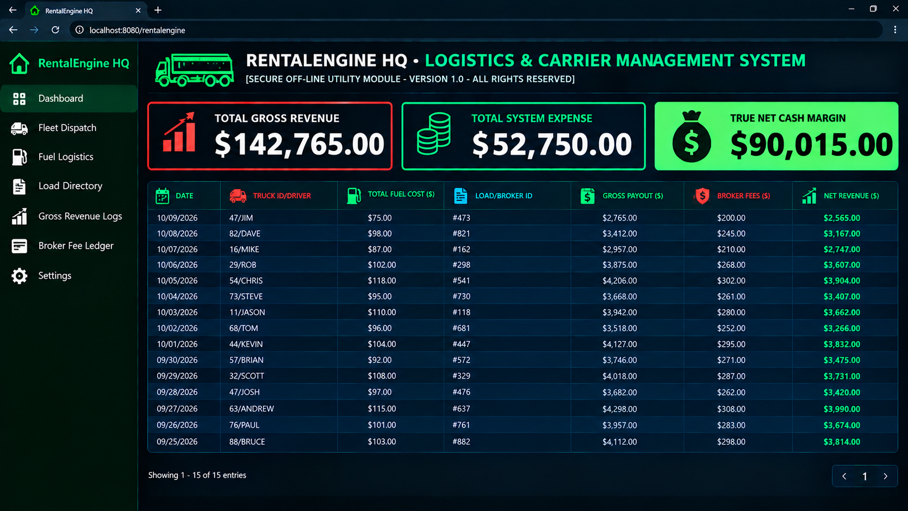

# Logistics Carrier OS - Fleet Management Ledger

Corporate Operations Back-Office Dashboard & Standalone Management Engine

> ### 🔑 SECURE ENTERPRISE PROCURE CONDUIT
> Bypass bloated monthly software licensing fees instantly. Secure your permanent, offline dark-mode corporate Excel operating workbook below:
> 
> <a href="https://gumroad.com" target="_blank" style="display: inline-block; background-color: #007bff; color: white; padding: 12px 24px; text-decoration: none; border-radius: 6px; font-weight: bold; font-size: 16px; margin: 8px 0; text-align: center; box-shadow: 0 3px 5px rgba(0,0,0,0.1);">👉 PROCURE THE OPERATION ENGINE NOW (\$149.00)</a>
> 
> *⚡ One-Time Corporate License. Permanent Local Ownership. Instant Vault Delivery.*

---

Welcome to the off-grid documentation node for the specialized Back-Office Operating System framework—a break-proof enterprise ledger engineered exclusively for elite Microsoft Excel (.xlsx) local deployments. Designed explicitly to lower monthly business software overhead, this standalone layout handles commercial dispatch tracking, real-time job costing, operational cost burn, and true net margin profit calculations natively on background formula automation.

🔒 **100% Corporate Vault-Secured:** This industrial spreadsheet utility is completely Macro-Free, formula-locked, and cleared of tracking scripts to instantly satisfy strict company data firewalls.
